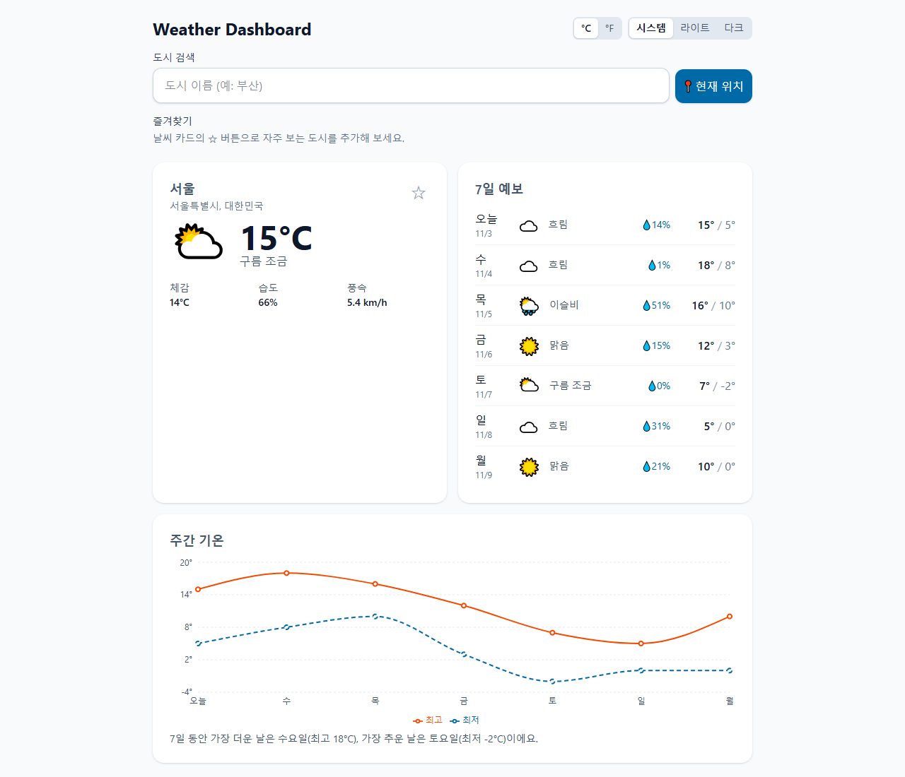
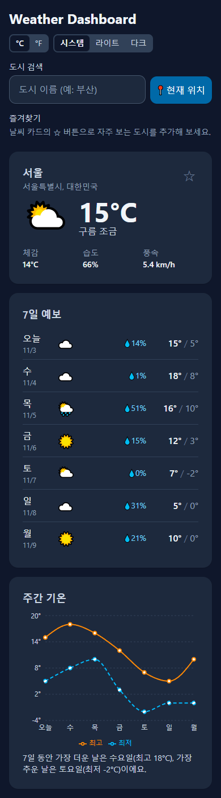

# Weather Dashboard

도시를 검색하거나 현재 위치로 현재 날씨, 7일 예보, 주간 기온 차트를 보여주는 웹 앱입니다.

- 배포 링크: (Vercel 배포 후 추가)
- [](https://github.com/jhkl1346/weather-dashboard/actions/workflows/ci.yml)

| 데스크톱 (라이트)                                    | 모바일 (다크)                                                              |
| ---------------------------------------------------- | -------------------------------------------------------------------------- |
|  |  |

## 주요 기능

- **도시 검색**: 입력이 멈추면(300ms) 검색하고, 결과를 마우스나 키보드(↑ ↓ Enter, Esc)로 고릅니다. 같은 이름의 도시는 시·도를 함께 보여 줍니다.
- **현재 날씨**: 기온, 체감 온도, 습도, 풍속과 날씨 아이콘·설명
- **7일 예보**: 요일, 날씨, 강수 확률, 최고/최저 기온
- **주간 기온 차트**: 최고/최저 기온 꺾은선 그래프와 스크린 리더용 텍스트 요약
- **현재 위치**: 브라우저 위치 권한으로 조회하고, 거부·시간 초과 등 원인별로 안내합니다.
- **즐겨찾기**: 자주 보는 도시를 저장하고 한 번에 조회합니다.
- **설정 저장**: 섭씨/화씨, 시스템/라이트/다크 테마, 마지막으로 본 도시를 기억합니다.
- **상태 처리**: 로딩 스켈레톤, 원인별 에러 메시지와 다시 시도, 검색 결과 없음

## 기술 스택과 선택 이유

| 영역        | 선택                           | 이유                                                                         |
| ----------- | ------------------------------ | ---------------------------------------------------------------------------- |
| 프레임워크  | React + Vite                   | 가장 널리 쓰이고, 개발 서버와 빌드가 빠릅니다.                               |
| 언어        | TypeScript                     | API 응답을 타입으로 정의해 잘못된 필드 사용을 미리 막습니다.                 |
| 서버 상태   | TanStack Query                 | 캐싱, 로딩/에러 상태, 재시도, 요청 취소를 직접 구현하지 않고 선언적으로 처리 |
| 차트        | Recharts                       | React 컴포넌트 방식이라 설정이 간단합니다. (지연 로딩으로 첫 화면에서 분리)  |
| 스타일      | Tailwind CSS                   | 반응형과 다크 모드를 클래스만으로 빠르게 적용합니다.                         |
| 테스트      | Vitest + React Testing Library | Vite 설정을 그대로 쓰고, 사용자가 보는 방식(역할, 레이블)으로 테스트합니다.  |
| 린트/포맷   | oxlint + Prettier              | 빠르고 설정이 간단합니다.                                                    |
| 날씨 데이터 | Open-Meteo                     | API 키가 없어 키 노출 걱정 없이 바로 쓸 수 있습니다.                         |
| 도시 검색   | Photon (OpenStreetMap)         | 국내 시·군을 빠짐없이 찾을 수 있습니다. (아래 트러블슈팅 참고)               |

## 실행 방법

Node.js 24 이상이 필요합니다.

```bash
npm install
npm run dev      # 개발 서버 (http://localhost:5173)
npm test         # 테스트
npm run lint     # 린트
npm run build    # 프로덕션 빌드
```

`main`에 push하거나 PR을 올리면 GitHub Actions가 포맷·린트·테스트·빌드를 자동으로 확인합니다.

## 폴더 구조

```
src/
├─ api/          # Open-Meteo·Photon 요청, 응답 → 앱 타입 변환, 에러 분류
├─ components/   # 화면 컴포넌트 (검색창, 현재 날씨, 예보, 차트, 즐겨찾기, 설정)
│  └─ states/    # 로딩 스켈레톤, 에러, 빈 상태
├─ hooks/        # useWeather, useCitySearch, useDebounce, useGeolocation, useFavorites, useTheme, useLocalStorage
├─ lib/          # 날씨 코드 매핑, 단위 변환, 날짜·지역 포맷, 차트 데이터
├─ types/        # 도메인 타입 (City, CurrentWeather, DailyWeather)
└─ test/         # 테스트 공통 설정과 샘플 응답
```

## 품질 점검

- **Lighthouse** (프로덕션 빌드 기준): 접근성 100, 권장사항 100, 성능 데스크톱 100 / 모바일 73
- **axe-core**: 라이트·다크 모드 모두 WCAG 2.1 AA 위반 0건
- **키보드만으로 사용**: 설정 → 검색 → 결과 선택 → 즐겨찾기까지 Tab, 방향키, Enter로 동작
- **반응형**: 360px, 768px, 1024px, 1280px에서 가로 스크롤 없이 표시
- **테스트**: 19개 파일, 87개 테스트 (변환 함수, 훅, 컴포넌트, 앱 흐름)

## 트러블슈팅 기록

### 1. 도시 검색에서 한국 시·군이 빠지거나 엉뚱한 지역이 나옴

- **문제**: 처음 쓴 Open-Meteo 지오코딩에서 '삼척', '보은'이 검색되지 않고, '광주'를 찾으면 충청남도의 작은 마을이, '전주'를 찾으면 북한 지역이 섞여 나왔습니다.
- **원인**: 해당 API는 GeoNames 데이터를 쓰는데, 한국 행정구역 데이터가 부족하고 이름만 같은 작은 마을까지 모두 돌려줍니다.
- **해결**: OpenStreetMap 기반의 Photon으로 바꾸고, 한국 범위(bbox)·국가 코드(KR)·장소 종류(시·군)로 결과를 걸렀습니다. 같은 군이 두 번 나오는 경우는 하나로 합쳤고, 국내 시·군 106곳을 실제 API로 모두 검색해 확인했습니다.

### 2. 차트 라이브러리 때문에 첫 화면 JS가 641kB

- **문제**: Recharts를 넣은 뒤 첫 화면에서 받는 JS가 641kB로 커졌습니다.
- **원인**: 차트는 화면 아래쪽에 있는데도, 앱 전체 코드와 함께 한 파일로 묶였습니다.
- **해결**: `React.lazy`와 `Suspense`로 차트 컴포넌트를 따로 불러오게 바꿔 첫 화면 JS를 275kB로 줄였습니다. 차트를 불러오는 동안에는 같은 크기의 스켈레톤을 보여 줘서 화면이 덜컹거리지 않게 했습니다.

### 3. 다크 모드에서 새로고침하면 흰 화면이 잠깐 번쩍임

- **문제**: 다크 모드를 저장해 두고 새로고침하면, React가 뜨기 전 잠깐 밝은 화면이 보였습니다.
- **원인**: 테마를 React 코드(`useTheme`)에서만 적용해서, JS를 받고 실행하기 전까지는 기본(라이트) 화면이었습니다.
- **해결**: `index.html`의 `<head>`에 짧은 스크립트를 넣어, 화면을 그리기 전에 저장된 테마를 먼저 적용했습니다.

### 4. 태블릿 폭(768px)에서 예보 설명이 강수 확률과 겹침

- **문제**: 2열 레이아웃에서 '약한 이슬비' 같은 긴 설명이 옆의 강수 확률 글자 위로 넘쳤습니다.
- **원인**: 좁은 화면에서 설명을 숨기려고 쓴 `sr-only`를 다시 보이게 하는 `sm:not-sr-only`가 `overflow: visible`을 함께 설정해서, 말줄임(`truncate`)이 무효가 됐습니다. 또 768px에서는 카드 폭이 좁아 설명이 들어갈 자리가 32px밖에 없었습니다.
- **해결**: 말줄임은 안쪽 `span`에 따로 두고, 2열 레이아웃은 1024px 이상에서만 쓰도록 바꿨습니다.

### 5. Windows에서 줄바꿈만 다른 변경이 계속 생김

- **문제**: 아무것도 고치지 않았는데 `git status`에 파일이 바뀌었다고 나오고, Prettier 검사도 실패했습니다.
- **원인**: Windows의 Git 설정(`core.autocrlf`)이 줄바꿈을 CRLF로 바꿔 내려받았습니다.
- **해결**: `.gitattributes`로 모든 텍스트 파일의 줄바꿈을 LF로 고정했습니다.

## 개선 계획

- 모바일 성능 점수(73) 개선: 첫 화면 JS를 더 나누고, 메인 스레드 작업 시간 줄이기
- 시간별(24시간) 예보
- API 키가 필요한 날씨 API로 바꾸고, 서버리스 함수로 키 숨기기
- PWA(오프라인 캐시, 홈 화면 추가), 다국어(한/영)

## 개발 계획

전체 기획과 마일스톤은 [SPEC.md](./SPEC.md)를 참고하세요.
